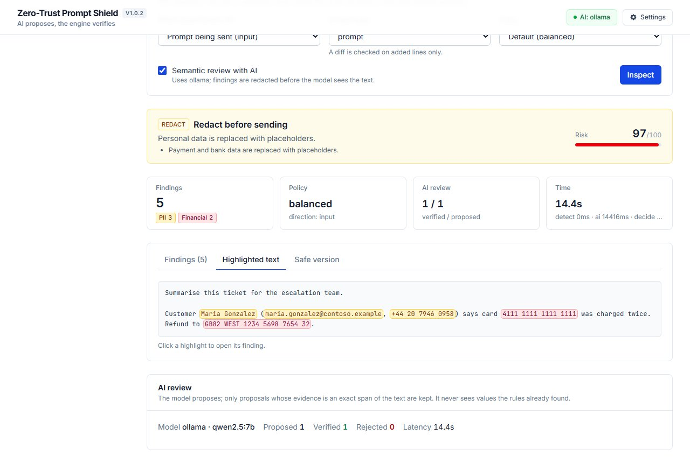
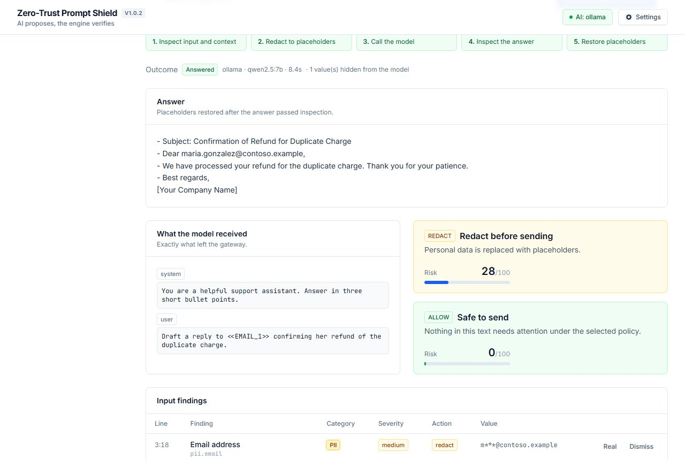
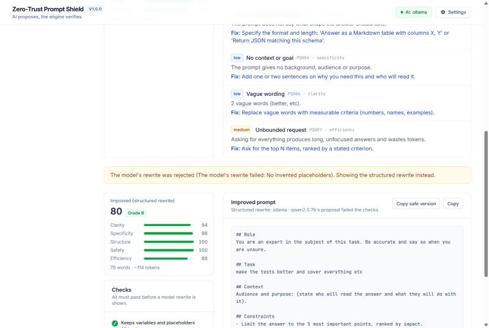
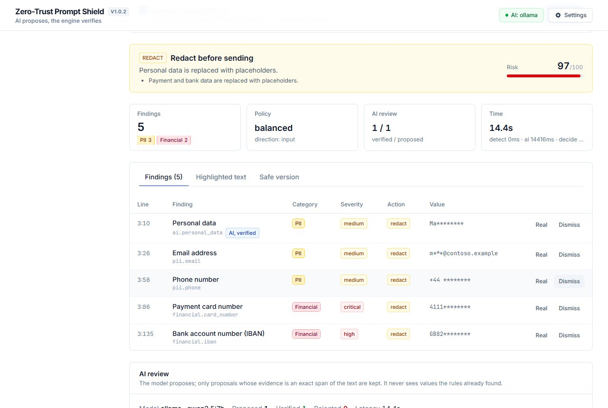
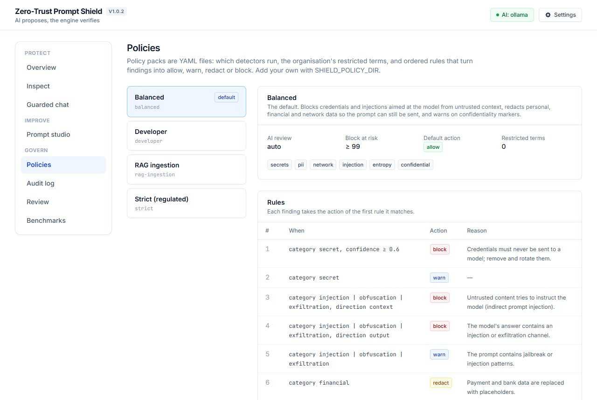
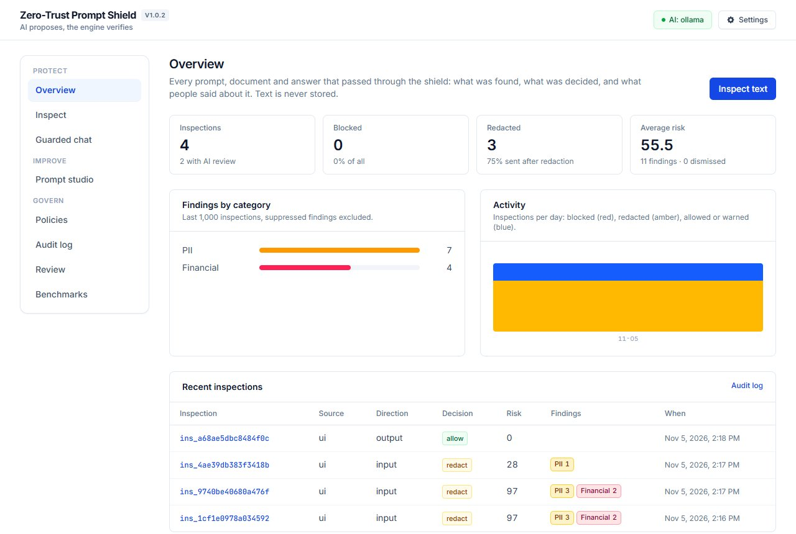
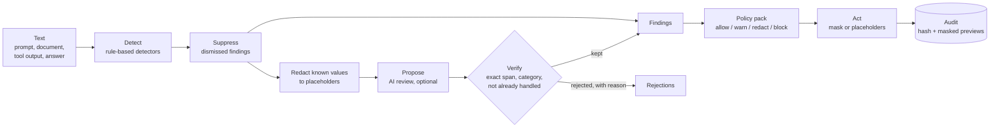

# Zero-Trust Prompt Shield

[](https://github.com/abulslab/Zero-Trust-Prompt-Shield/actions/workflows/ci.yml)
[](LICENSE)
[](pyproject.toml)
[](#ai-providers)

**A zero-trust gateway for everything that goes into and comes out of large language models.** It inspects prompts,
retrieved documents, tool output and model answers; redacts what must not leave; blocks injections aimed at the
model; scores and improves the prompts themselves; and keeps an audit trail that never contains the text it protected.

> **AI proposes, the engine verifies.**
> Rule-based detectors decide what is a finding. A model may propose more (a customer's name, an internal threshold,
> an instruction hidden in prose), but a proposal counts only once the engine has tied it to an exact span of the text.
> The model never sees the values the rules already found, and everything works with no model at all.



---

## Why

Teams adopting LLMs live with four gaps:

| Gap | What it costs |
|---|---|
| **Data leaves by copy and paste.** Credentials, customer records and internal architecture go into prompts every day. | Rotated keys, privacy incidents, contracts breached by a chat window. |
| **Untrusted text gets to instruct the model.** A web page, a PDF or a tool result can carry "ignore your instructions". | Indirect prompt injection: agents that leak data or act on an attacker's behalf. |
| **Answers are trusted by default.** A model can echo personal data or return a markdown image that beacons the conversation out. | Data exfiltration through the rendered answer. |
| **Prompts are written by feel.** Vague, unbounded, conflicting prompts produce unreliable output and waste tokens. | Rework, cost, and inconsistent quality nobody can measure. |

## What it does

| Capability | How |
|---|---|
| **Inspect** | 22 credential rules (provider key formats, private keys, tokens, connection strings, password assignments), personal and financial data with checksum validation (Luhn, IBAN, SSN ranges), internal IPs and host names, confidentiality markers, your organisation's restricted terms, and random-looking tokens. Diffs are checked on added lines only. |
| **Injection defence** | Instruction overrides, jailbreak personas, chat-template role markers, system-prompt extraction, tool hijacking, instructions hidden in HTML, invisible and bidi characters, base64-smuggled instructions, markdown-image exfiltration. The same sentence is a warning in your own prompt and a block inside a retrieved document. |
| **Verified AI review** | An optional model looks for what patterns cannot: names, health data, customers, strategy, security-control details. It only ever sees redacted text, and every proposal must pass the verifier (below). Rejections are shown with their reason. |
| **Reversible redaction** | Values become stable placeholders (`<<EMAIL_1>>`); the mapping goes back to the caller, never to storage. Send the redacted prompt, restore the values in the answer. |
| **Guarded chat** | The full gateway in one call: inspect the conversation and untrusted context, redact, call the model, inspect the answer, restore. Injections are blocked before the model is called. |
| **Prompt studio** | Lints prompts on clarity, specificity, structure, safety and efficiency (16 checks), with a fix for each. A model may propose a rewrite; it is kept only if it keeps every variable, invents no placeholders, adds no sensitive data, scores higher and stays a sensible length. Otherwise a deterministic structured rewrite is used. |
| **Policy as code** | YAML packs (balanced, strict, developer, RAG ingestion, or your own) choose detectors, restricted terms and ordered rules that map findings to allow, warn, redact or block. |
| **Learning from review** | People mark findings as real or dismiss them. Dismissals match by fingerprint, so the shield remembers a false positive without storing the value. |
| **Audit without exposure** | Every decision is logged with a SHA-256 of the text, its length and masked previews. Never the text, never a raw value. |
| **Everywhere you work** | Web UI, REST API with OpenAPI docs, CLI with SARIF output, GitHub Action, pre-commit hook, Docker Compose. |

## How the verifier keeps AI honest

Every model proposal passes these deterministic checks before it becomes a finding:

1. The category is in a fixed taxonomy, and confidence is at least 0.55.
2. The evidence is an exact span of the text the model was shown (whitespace-tolerant, otherwise character for character).
3. The quote is not just a placeholder for something the rules already handled; if it runs over one, it is trimmed to
   the part the model actually added, and rejected if nothing meaningful is left.
4. An "injection" must actually address or instruct an AI; "personal data" and "customer" quotes must contain a name,
   number or identifier.
5. Rule findings always win an overlap: a precise rule match is never replaced by a broader AI quote.

Each of these rules exists because a live model broke it during testing; each has a regression test.

## Tested with a local model

Measured on 2026-11-05 with **Ollama `qwen2.5:7b`** running locally, using the demo inputs in the UI:

| Path | Result |
|---|---|
| AI review | On a support note with a token, an email, a customer, an internal fraud rule and a pricing plan, the model added (across runs) the customer's name, the bank, the fraud-control detail and the pricing plan; the rules kept the token and email. The verifier rejected the model's paraphrases, placeholder-only quotes and a mislabelled "injection". **No value the rules had found was ever sent to the model.** About 13 to 40 seconds per review. |
| Prompt optimiser | The model's rewrite passed every check in 2 of 6 runs (score 52 to 76 and 88). In three runs it invented placeholders or lowered the score, and one hit a transient Ollama error; each time the structured rewrite was returned instead (score 52 to 74). About 20 to 65 seconds. |
| Guarded chat | The model received `<<EMAIL_1>>`; the real address was restored in its answer. With an injection in the tool output, the request was blocked and the model was never called. About 5 to 8 seconds. |

A 7B local model finds less than a large hosted one and varies from run to run; the verifier is what makes it safe to
use. Gemini results will be added once measured.

<table>
  <tr>
    <td></td>
    <td></td>
  </tr>
  <tr>
    <td></td>
    <td></td>
  </tr>
  <tr>
    <td colspan="2"></td>
  </tr>
</table>

## Quick start

**Docker (everything):**

```bash
docker compose up --build
```

UI at http://localhost:3200, API docs at http://localhost:5380/docs.

**Local development** (Python 3.11+, Node 20+), from the repository root:

```bash
python -m venv .venv
.venv/Scripts/activate            # macOS/Linux: source .venv/bin/activate
pip install -e ".[dev]"
promptshield serve --reload       # API on http://localhost:5380
```

```bash
cd web && npm install && npm run dev    # UI on http://localhost:3200
```

Everything works without a model. To turn on the AI features, see [AI providers](#ai-providers).

## AI providers

Create a `.env` file in the folder you start the API from (the repository root). It is git-ignored; never commit it.

**Fully local with Ollama** (no data leaves your machine):

```bash
ollama pull qwen2.5:7b
```

```
SHIELD_AI_PROVIDER=ollama
SHIELD_OLLAMA_MODEL=qwen2.5:7b
```

**Hosted** (one of):

```
SHIELD_AI_PROVIDER=gemini
GEMINI_API_KEY=your-key
```

```
SHIELD_AI_PROVIDER=anthropic       # or openai (any OpenAI-compatible endpoint via SHIELD_OPENAI_BASE_URL)
ANTHROPIC_API_KEY=your-key
```

Model calls time out after 30 seconds for hosted providers and 180 seconds for Ollama (`SHIELD_AI_TIMEOUT_S`
overrides both), and are retried once on a server error. All settings are listed in [.env.example](.env.example).

## Use it

**API**

```bash
curl -s localhost:5380/v1/inspect -H "Content-Type: application/json" \
  -d '{"content": "Email ana@contoso.example about the refund", "direction": "input"}'
```

**CLI and CI**

```bash
promptshield scan --diff                          # staged changes, added lines only
promptshield scan prompts/ --format sarif > shield.sarif
promptshield lint prompts/support.prompt --min-score 70
promptshield redact notes.txt --mapping mapping.json
promptshield benchmark
```

**GitHub Action**

```yaml
- uses: abulslab/Zero-Trust-Prompt-Shield@main
  with:
    paths: prompts/
    fail-on: block
```

**pre-commit**

```yaml
repos:
  - repo: https://github.com/abulslab/Zero-Trust-Prompt-Shield
    rev: main
    hooks: [{ id: promptshield }]
```

More patterns (redact, call, restore; screening RAG documents) in [docs/integrations.md](docs/integrations.md).

## How it works



Read [docs/architecture.md](docs/architecture.md) for the layers and ports, the [ADRs](docs/adr) for the decisions,
and [docs/security-model.md](docs/security-model.md) for the threat model.

## Repository layout

```
backend/src/promptshield/
  domain/        findings, spans, decisions (no I/O)
  detection/     rule-based detectors behind the Detector port
  ai/            model gateway (plain HTTP providers) and the semantic reviewer + verifier
  policy/        policy engine and YAML packs
  quality/       prompt linter and optimiser
  redaction.py   reversible and one-way redaction
  service.py     the pipeline every entry point shares
  audit.py       audit and feedback store (SQLite behind a port)
  api/           FastAPI app
  cli.py         command line
  eval/          labelled corpus and benchmark
backend/tests/   88 tests, including a scripted model for every AI path and hostile-input timing
web/             Next.js UI
docs/            architecture, ADRs, threat model, integrations, roadmap, screenshots
```

## Quality

- 88 backend tests, including a regular-expression denial-of-service guard; ruff, mypy, ESLint and a TypeScript check; all in CI with a Docker build.
- A labelled corpus of 41 samples with hard negatives (hashes, UUIDs, placeholders, environment references, removed
  diff lines, public IPs, security discussions). `promptshield benchmark` fails the build on any missed sample.
- Credential-shaped test values are assembled at run time, so the repository holds nothing a secret scanner would flag.

## Honest limits

- Rule-based detection is pattern matching: precise on known formats, blind to novel ones. The entropy rule and AI
  review narrow that gap; they do not close it.
- The benchmark corpus was written alongside the detectors. It shows the rules behave as designed on known cases, not
  real-world accuracy. Add your own samples.
- Injection detection catches known techniques. Treat it as one layer: keep untrusted content delimited, give agents
  least privilege, and require confirmation for consequential actions.
- AI review quality depends on the model. Small local models miss things and vary between runs; the verifier stops them
  from inventing findings, not from missing them.
- The lint score is a heuristic. It flags likely problems; it does not judge whether the task itself is right.

## Contributing and security

See [CONTRIBUTING.md](CONTRIBUTING.md). Report vulnerabilities privately as described in [SECURITY.md](SECURITY.md).

## License

[MIT](LICENSE)
