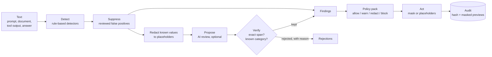

# Zero-Trust Prompt Shield

[](https://github.com/abulslab/Zero-Trust-Prompt-Shield/actions/workflows/ci.yml)
[](LICENSE)
[](docker-compose.yml)

**A zero-trust gateway for everything that goes into and comes out of large language models.** It inspects prompts,
retrieved documents, tool output and model answers; redacts what must not leave; blocks injections aimed at the model;
scores and improves the prompts themselves; and keeps an audit trail that never contains the text it protected.

> **AI proposes, the engine verifies.**
> Rule-based detectors decide what is a finding. A model may propose more (a customer's name, an internal threshold, an
> instruction hidden in prose), but a proposal counts only once the engine has tied it to an exact span of the text.
> The model never sees the values the rules already found, and everything works with no model at all.

---

## The problem

Teams adopting LLMs live with the same four gaps:

| Gap | What it costs |
|---|---|
| **Data leaves by copy and paste.** Credentials, customer records and internal architecture go into prompts every day. | Rotated keys, privacy incidents, contracts breached by a chat window. |
| **Untrusted text gets to instruct the model.** A web page, a PDF or a tool result can carry "ignore your instructions". | Indirect prompt injection: agents that leak data or act on an attacker's behalf. |
| **Answers are trusted by default.** A model can echo personal data or return a markdown image that beacons the conversation out. | Data exfiltration through the rendered answer. |
| **Prompts are written by feel.** Vague, unbounded, conflicting prompts produce unreliable output and waste tokens. | Rework, cost, and inconsistent quality that nobody can measure. |

## Capabilities

| Capability | What it does |
|---|---|
| **Inspect** | Rule-based detectors for 20+ credential formats, personal and financial data (with Luhn, IBAN and SSN checks), internal infrastructure, confidentiality markers and your own restricted terms. Diffs are checked on added lines only. |
| **Injection defence** | Instruction overrides, jailbreak personas, chat-template role markers, system-prompt extraction, tool hijacking, instructions hidden in HTML, invisible and bidi characters, base64-smuggled instructions, markdown-image exfiltration. Severity depends on where the text sits: the same sentence is a warning in a prompt and a block in a retrieved document. |
| **Verified AI review** | An optional model looks for what rules cannot: names, health data, customers, strategy, security-control details. It only sees redacted text, and every proposal is checked: known category, enough confidence, evidence that is an exact span. Rejections are reported with their reason. |
| **Reversible redaction** | Values become stable placeholders (`<<EMAIL_1>>`); the mapping goes back to the caller, never to storage. Send the redacted prompt, restore values in the answer. |
| **Guarded chat** | The full gateway in one call: inspect input and untrusted context, redact, call the model, inspect the answer, restore. Blocks before the model is ever called when it should. |
| **Prompt studio** | Lints prompts on clarity, specificity, structure, safety and efficiency, with a fix for each issue. Optimisation lets a model propose a rewrite and keeps it only if it preserves every variable and placeholder, adds no sensitive data and scores higher; otherwise a deterministic structured rewrite is used. |
| **Policy as code** | YAML packs (balanced, strict, developer, RAG ingestion, or your own) choose detectors, restricted terms and ordered rules that map findings to allow, warn, redact or block. |
| **Learning from review** | People mark findings as real or not an issue. Suppressions match by fingerprint, so the shield remembers a false positive without storing the value. |
| **Audit without exposure** | Every decision is logged with a SHA-256 of the text, its length and masked previews. Never the text, never a raw value. |
| **Everywhere you work** | REST API with OpenAPI docs, a CLI with SARIF output, a GitHub Action, a pre-commit hook, and a web UI. |
| **Model-agnostic, AI-optional** | Gemini, Ollama (fully local), Anthropic or any OpenAI-compatible endpoint behind one gateway with a timeout and input cap. Without a model every feature still works, rules only. |
| **Measured** | A labelled corpus with hard negatives and a precision/recall benchmark in the CLI, the API and the UI. |

## How it works



Read [docs/architecture.md](docs/architecture.md) for the layers, ports and decisions, and the [ADRs](docs/adr) for why.

## Quick start

**Docker (everything):**

```bash
docker compose up --build
```

UI at http://localhost:3200, API at http://localhost:5380/docs.

**Local development:**

```bash
python -m venv .venv && .venv/Scripts/activate      # source .venv/bin/activate on macOS/Linux
pip install -e "backend[dev]"
promptshield serve --reload                         # API on :5380
```

```bash
cd web && npm install && npm run dev                # UI on :3200
```

**Turn on AI features** by creating `backend/.env` (never commit it):

```bash
SHIELD_AI_PROVIDER=gemini        # gemini | ollama | anthropic | openai | none
GEMINI_API_KEY=your-key
```

## Use it

**API**

```bash
curl -s localhost:5380/v1/inspect -H "Content-Type: application/json" \
  -d '{"content": "Email ana@contoso-mail.com about the refund", "direction": "input"}'
```

**CLI and CI**

```bash
promptshield scan --diff                     # staged changes, added lines only
promptshield scan prompts/ --format sarif > shield.sarif
promptshield lint prompts/support.prompt --min-score 70
promptshield redact notes.txt --mapping mapping.json
promptshield benchmark
```

**GitHub Action**

```yaml
- uses: abulslab/Zero-Trust-Prompt-Shield@main
  with:
    paths: prompts/
    fail-on: block
```

**pre-commit**

```yaml
repos:
  - repo: https://github.com/abulslab/Zero-Trust-Prompt-Shield
    rev: main
    hooks: [{ id: promptshield }]
```

More in [docs/integrations.md](docs/integrations.md).

## Repository layout

```
backend/src/promptshield/
  domain/        findings, spans, decisions (no I/O)
  detection/     rule-based detectors behind the Detector port
  ai/            model gateway (providers over plain HTTP) and the semantic reviewer + verifier
  policy/        policy engine and YAML packs
  quality/       prompt linter and optimiser
  redaction.py   reversible and one-way redaction
  service.py     the pipeline every entry point shares
  audit.py       audit and feedback store (SQLite behind a port)
  api/           FastAPI app
  cli.py         command line
  eval/          labelled corpus and benchmark
web/             Next.js UI (same design system as Autonomous Bug Hunter)
docs/            architecture, ADRs, threat model, policies, integrations, roadmap
```

## Honest limits

- Rule-based detection is pattern matching. It is precise on known formats and blind to novel ones; the entropy rule and
  AI review narrow that gap, they do not close it.
- The benchmark corpus was written alongside the detectors. It shows the rules behave as designed on known cases, not
  real-world accuracy. Add your own samples.
- Injection detection catches known techniques. Treat it as one layer: keep untrusted content delimited, give agents
  least privilege, and require confirmation for consequential actions.
- The lint score is a heuristic. It flags likely problems; it does not judge whether the task itself is right.

See [docs/security-model.md](docs/security-model.md) for the threat model.

## License

[MIT](LICENSE)
