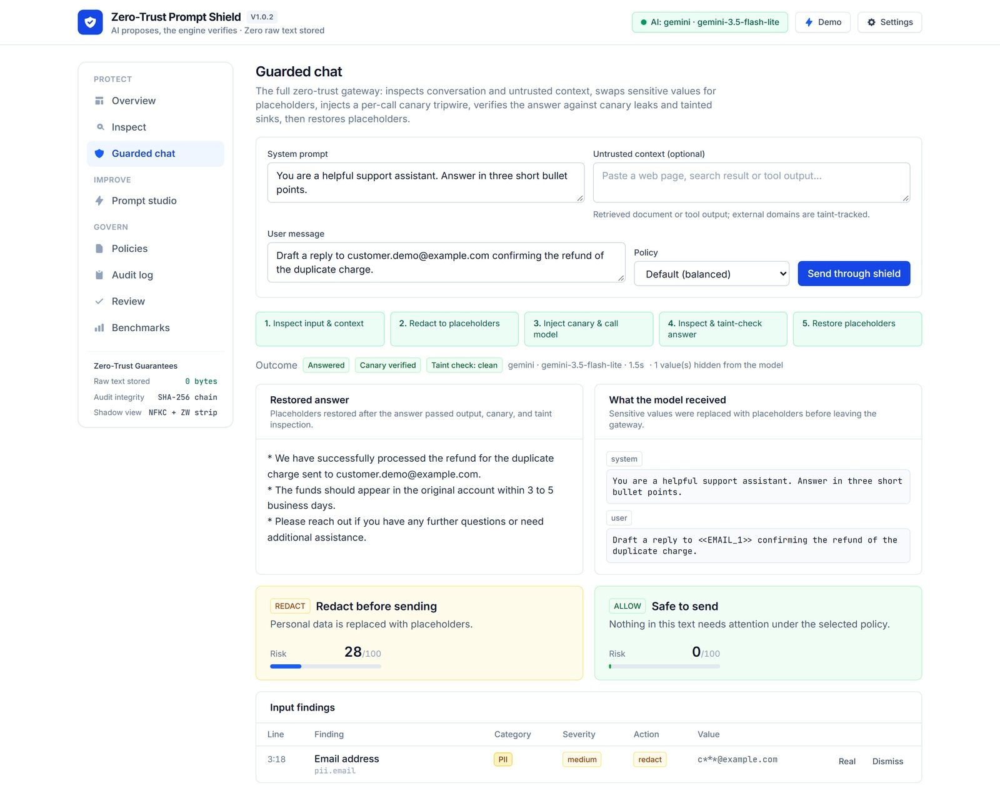
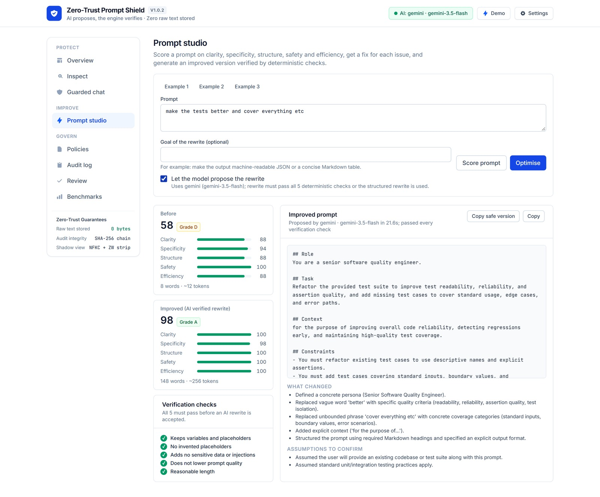
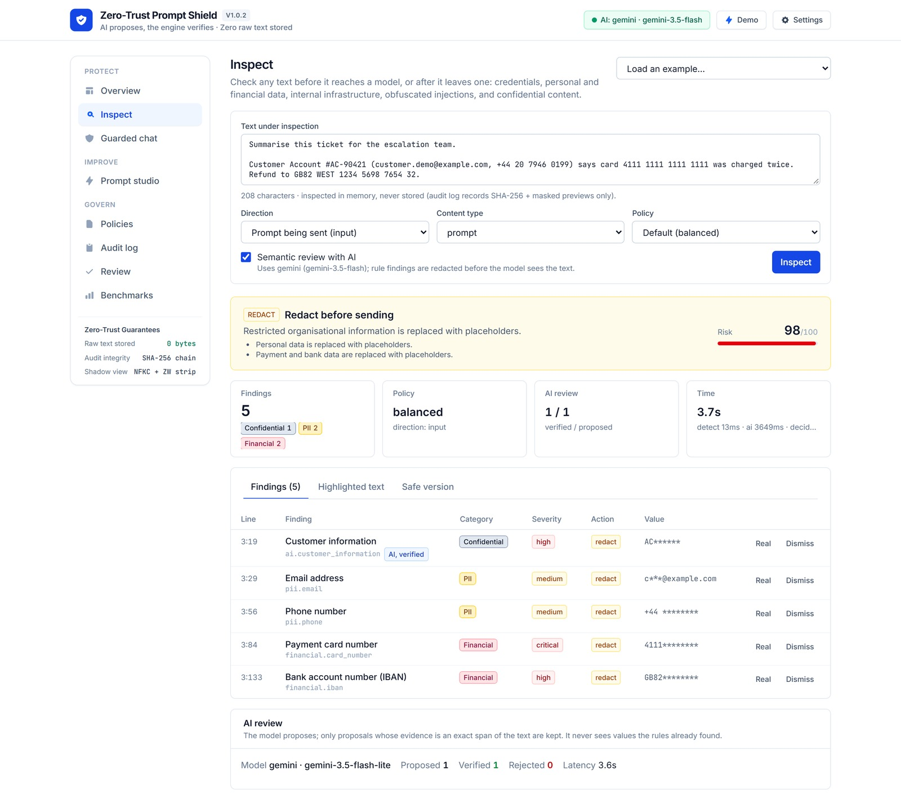
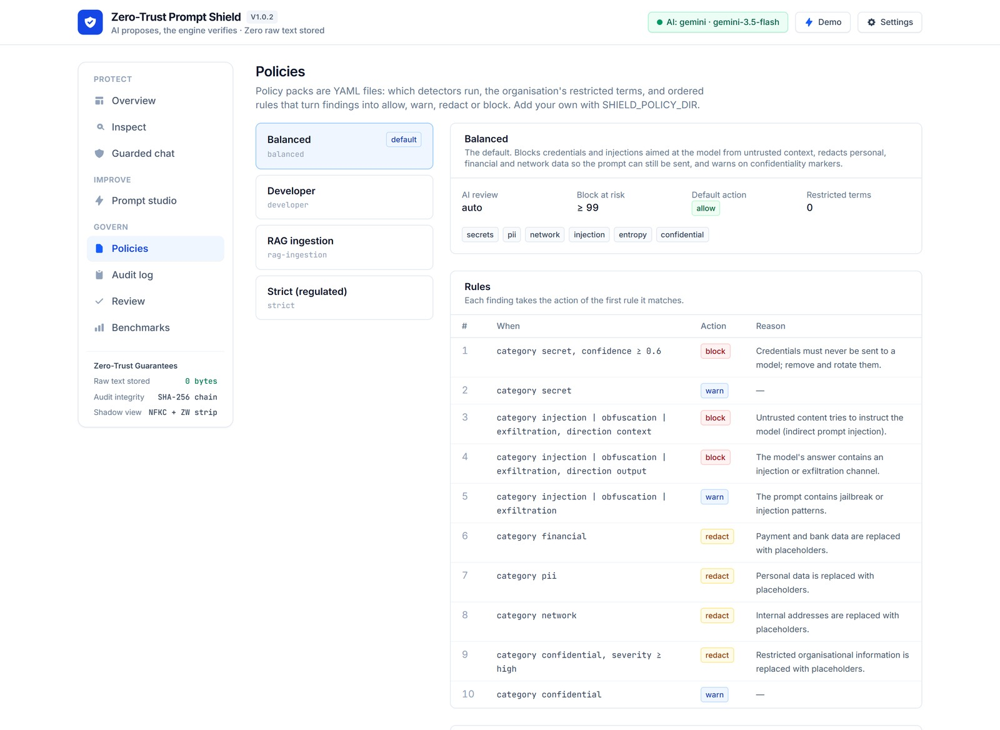
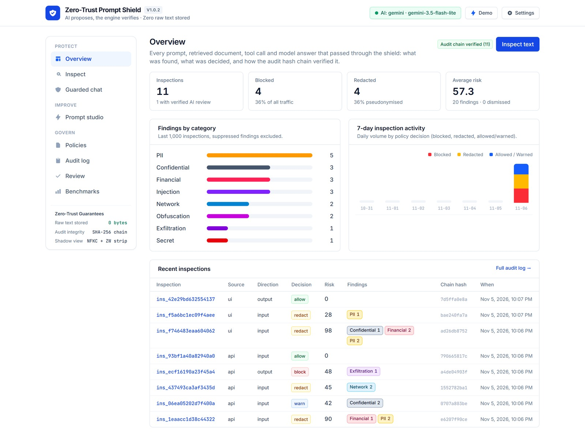
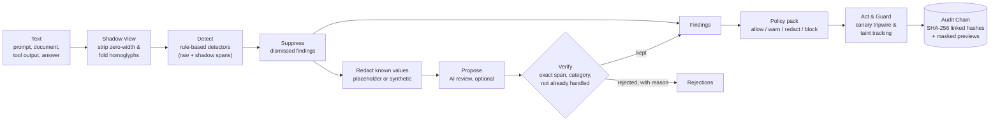

# Zero-Trust Prompt Shield

[](https://github.com/abulslab/Zero-Trust-Prompt-Shield/actions/workflows/ci.yml)
[](LICENSE)
[](pyproject.toml)
[](#ai-providers)

**A zero-trust gateway for everything that goes into and comes out of large language models.** It inspects prompts,
retrieved documents, tool output, agent tool calls and model answers; redacts what must not leave; blocks direct,
indirect and obfuscated injections; tracks untrusted data taint and ephemeral canary tripwires across the model
boundary; scores and improves prompts; and keeps a tamper-evident SHA-256 hash-chained audit trail that never contains
the text it protected.

> **AI proposes, the engine verifies.**
> Rule-based detectors decide what is a finding. A model may propose more (a customer's name, an internal threshold,
> an instruction hidden in prose), but a proposal counts only once the engine has tied it to an exact span of the text.
> The model never sees the values the rules already found, and everything works with no model at all.

---

## Why

Teams adopting LLMs live with four gaps:

| Gap | What it costs |
|---|---|
| **Data leaves by copy and paste.** Credentials, customer records and internal architecture go into prompts every day. | Rotated keys, privacy incidents, contracts breached by a chat window. |
| **Untrusted text gets to instruct the model.** A web page, a PDF or a tool result can carry "ignore your instructions". | Indirect prompt injection: agents that leak data or act on an attacker's behalf. |
| **Answers and tool calls are trusted by default.** A model can echo personal data, call an internal URL, or emit a link that beacons the conversation out to an attacker-controlled domain. | Data exfiltration and SSRF through rendered answers or agent tool execution. |
| **Prompts are written by feel.** Vague, unbounded, conflicting prompts produce unreliable output and waste tokens. | Rework, cost, and inconsistent quality nobody can measure. |

## What it does

| Capability | How |
|---|---|
| **Inspect** | 22 credential rules (provider key formats, private keys, tokens, connection strings, password assignments), personal and financial data with checksum validation (Luhn, IBAN, SSN ranges), internal IPs and host names, confidentiality markers, your organisation's restricted terms, and random-looking tokens. Diffs are checked on added lines only. |
| **Coordinate-preserving de-obfuscation** | Builds a shadow projection that strips invisible Unicode controls (zero-width spaces, soft hyphens, bidi overrides, Unicode tags) and folds Cyrillic/Greek/full-width homoglyphs back to ASCII while mapping every matched span back to exact line, column and character offsets in the original text ([ADR 0008](docs/adr/0008-coordinate-preserving-deobfuscation-shadow-view.md)). |
| **Injection defence** | Instruction overrides, jailbreak personas, chat-template role markers, system-prompt extraction, tool hijacking, instructions hidden in HTML, invisible and bidi characters, base64-smuggled instructions, markdown-image exfiltration. The same sentence is a warning in your own prompt and a block inside a retrieved document. |
| **Verified AI review** | An optional model looks for what patterns cannot: names, health data, customers, strategy, security-control details. It only ever sees redacted text, and every proposal must pass the deterministic verifier. Rejections are shown with their reason. |
| **Reversible & synthetic redaction** | `placeholder` mode uses stable labels (`<<EMAIL_1>>`); `synthetic` mode generates RFC-reserved format-preserving surrogates (`user1@redacted.invalid`, `192.0.2.1`, `+44 20 7946 0001`) so downstream parsers and code keep valid syntax; `mask` mode (`[REDACTED:EMAIL]`) is one-way. Mappings are returned to the caller and never stored ([ADR 0010](docs/adr/0010-tamper-evident-audit-chain-and-synthetic-redaction.md)). |
| **Guarded chat with canary tripwires & taint tracking** | Inspects the conversation and untrusted context, redacts, injects a per-request ephemeral canary token (`ZXQ-<hex>`) into the system boundary, calls the model, verifies the canary never leaked (`exfiltration.canary_leak`), blocks any output link or address targeting a domain introduced exclusively in untrusted context (`exfiltration.tainted_sink`), and restores placeholders ([ADR 0009](docs/adr/0009-canary-tripwires-taint-tracking-and-tool-guard.md)). |
| **Agent tool-call guard & OpenAI proxy** | `POST /v1/guard/tool` screens structured tool calls before execution for secrets, PII, SSRF targets (cloud metadata IPs, loopback, local schemes), shell command injection and tainted sinks. `POST /v1/chat/completions` provides a drop-in OpenAI-compatible proxy endpoint with `X-Shield-*` decision headers. |
| **Prompt studio** | Lints prompts on clarity, specificity, structure, safety and efficiency (16 checks), with a fix for each. A model may propose a rewrite; it is kept only if it keeps every variable, invents no placeholders, adds no sensitive data, scores higher and stays a sensible length. Otherwise a deterministic structured rewrite is used. |
| **Policy as code** | YAML packs (balanced, strict, developer, RAG ingestion, or your own) choose detectors, restricted terms and ordered rules that map findings to allow, warn, redact or block. |
| **Learning from review** | People mark findings as real or dismiss them. Dismissals match by fingerprint (`SHA-256` or `HMAC-SHA256` via `SHIELD_FINGERPRINT_KEY`), so the shield remembers a false positive without storing the value. |
| **Tamper-evident audit without exposure** | Every decision is logged with a SHA-256 of the text, its length, masked previews and a cryptographic hash-chain link (`prev_hash` -> `entry_hash`). Never the text, never a raw value. Verify the chain anytime via `GET /v1/audit/verify` or `promptshield audit-verify`. |
| **Adversarial mutation benchmark** | Evaluates precision, recall and F1 across the labelled corpus plus 90 deterministic adversarial mutations (zero-width splitting, Cyrillic homoglyph substitution, JSON wrapping, markdown code fences and unified git diffs). |
| **Everywhere you work** | Web UI, REST API with OpenAPI docs, drop-in OpenAI proxy, CLI with SARIF output, GitHub Action, pre-commit hook, Docker Compose. |

## Defense-in-depth highlights

What separates a production security gateway from a regex wrapper:

1. **Coordinate-preserving de-obfuscation shadow view ([ADR 0008](docs/adr/0008-coordinate-preserving-deobfuscation-shadow-view.md))**:
   Attackers split keywords with zero-width characters or replace ASCII letters with Cyrillic/Greek lookalikes. `Document` builds a normalised shadow view with an index projection table (`_norm_to_orig`), running detectors on both views and translating shadow matches back to exact character spans in the caller's original text. Pure-ASCII inputs short-circuit in C (`text.isascii()`) with zero overhead.
2. **Ephemeral canary tripwires ([ADR 0009](docs/adr/0009-canary-tripwires-taint-tracking-and-tool-guard.md))**:
   Regexes only catch known system-prompt extraction phrasings. During every guarded chat call, the shield mints a one-time token (`ZXQ-<hex>`) inside the system boundary instruction. If the token (raw, case-folded or base64-encoded) appears in the model's answer, `exfiltration.canary_leak` blocks the response with `confidence = 1.0`.
3. **Cross-boundary taint tracking ([ADR 0009](docs/adr/0009-canary-tripwires-taint-tracking-and-tool-guard.md))**:
   When an agent reads untrusted `context`, `tool` or `document` messages, the shield extracts every external domain introduced exclusively by that untrusted data. If the model's answer or a proposed tool call attempts to contact or link to a tainted domain, `exfiltration.tainted_sink` blocks the exfiltration channel even when the URL looks completely benign.
4. **Agent tool-call guard (`POST /v1/guard/tool`)**:
   Inspects structured JSON arguments before an agent executes a tool, blocking leaked credentials, SSRF targets (cloud metadata IPs, loopback, `file://`, `gopher://`), shell command chaining, and tainted sinks while redacting PII according to policy.
5. **Format-preserving synthetic redaction (`RedactionMode.SYNTHETIC`, [ADR 0010](docs/adr/0010-tamper-evident-audit-chain-and-synthetic-redaction.md))**:
   Replaces emails, phones, SSNs, private IPs, internal hosts and payment cards with deterministic RFC-reserved surrogates (`user1@redacted.invalid`, `192.0.2.1`, `+44 20 7946 0001`) so downstream code generators and validators see valid syntax, then restores the originals in the answer.
6. **HMAC-keyed fingerprints & tamper-evident audit hash chain ([ADR 0010](docs/adr/0010-tamper-evident-audit-chain-and-synthetic-redaction.md))**:
   Optional `SHIELD_FINGERPRINT_KEY` switches finding fingerprints to `HMAC-SHA256` so low-entropy values (phones, SSNs, internal IPs) cannot be brute-forced with rainbow tables. Every audit record links `prev_hash` to `entry_hash` (`SHA-256`) from `GENESIS`, verified via `GET /v1/audit/verify`, `promptshield audit-verify` and the Audit UI badge.

## How the verifier keeps AI honest

Every model proposal passes these deterministic checks before it becomes a finding:

1. The category is in a fixed taxonomy, and confidence is at least 0.55.
2. The evidence is an exact span of the text the model was shown (whitespace-tolerant, otherwise character for character).
3. The quote is not just a placeholder for something the rules already handled; if it runs over one, it is trimmed to
   the part the model actually added, and rejected if nothing meaningful is left.
4. An "injection" must actually address or instruct an AI; "personal data" and "customer" quotes must contain a name,
   number or identifier.
5. Rule findings always win an overlap: a precise rule match is never replaced by a broader AI quote.

Each of these rules exists because a live model broke it during testing; each has a regression test.

## Interface tour

<table>
  <tr>
    <td></td>
    <td></td>
  </tr>
  <tr>
    <td></td>
    <td></td>
  </tr>
  <tr>
    <td colspan="2"></td>
  </tr>
</table>

## Quick start

**Docker (everything):**

```bash
docker compose up --build
```

UI at http://localhost:3200, API docs at http://localhost:5380/docs.

**Local development** (Python 3.11+, Node 20+), from the repository root:

```bash
python -m venv .venv
.venv/Scripts/activate            # macOS/Linux: source .venv/bin/activate
pip install -e ".[dev]"
promptshield serve --reload       # API on http://localhost:5380
```

```bash
cd web && npm install && npm run dev    # UI on http://localhost:3200
```

Everything works without a model. To turn on the AI features, see [AI providers](#ai-providers).

## AI providers

Create a `.env` file in the folder you start the API from (the repository root). It is git-ignored; never commit it.

**Fully local with Ollama** (no data leaves your machine):

```bash
ollama pull qwen2.5:7b
```

```
SHIELD_AI_PROVIDER=ollama
SHIELD_OLLAMA_MODEL=qwen2.5:7b
```

**Hosted** (one of):

```
SHIELD_AI_PROVIDER=gemini
GEMINI_API_KEY=your-key
```

```
SHIELD_AI_PROVIDER=anthropic       # or openai (any OpenAI-compatible endpoint via SHIELD_OPENAI_BASE_URL)
ANTHROPIC_API_KEY=your-key
```

Model calls time out after 30 seconds for hosted providers and 180 seconds for Ollama (`SHIELD_AI_TIMEOUT_S`
overrides both), and are retried once on a server error. All settings are listed in [.env.example](.env.example).

## Use it

**API (Inspect, Tool Guard, OpenAI-compatible Proxy)**

```bash
# 1. Inspect text
curl -s localhost:5380/v1/inspect -H "Content-Type: application/json" \
  -d '{"content": "Email user1@example.com about the refund", "direction": "input"}'

# 2. Screen an agent tool call before execution
curl -s localhost:5380/v1/guard/tool -H "Content-Type: application/json" \
  -d '{"tool_name": "send_email", "arguments": {"to": "user1@example.com", "body": "Refund approved"}}'

# 3. Drop-in OpenAI-compatible chat completions proxy
curl -s localhost:5380/v1/chat/completions -H "Content-Type: application/json" \
  -d '{"model": "promptshield-guard", "messages": [{"role": "user", "content": "Draft a note to user1@example.com"}]}'
```

**CLI and CI**

```bash
promptshield scan --diff                          # staged changes, added lines only
promptshield scan prompts/ --format sarif > shield.sarif
promptshield lint prompts/support.prompt --min-score 70
promptshield redact notes.txt --mode synthetic --mapping mapping.json
promptshield audit-verify                         # verify tamper-evident SQLite hash chain
promptshield benchmark                            # corpus precision/recall + 90 adversarial mutations
```

**GitHub Action**

```yaml
- uses: abulslab/Zero-Trust-Prompt-Shield@main
  with:
    paths: prompts/
    fail-on: block
```

**pre-commit**

```yaml
repos:
  - repo: https://github.com/abulslab/Zero-Trust-Prompt-Shield
    rev: main
    hooks: [{ id: promptshield }]
```

More patterns (redact, call, restore; screening RAG documents; gating agent tools) in [docs/integrations.md](docs/integrations.md).

## How it works



Read [docs/architecture.md](docs/architecture.md) for the layers and ports, the [ADRs](docs/adr) for the decisions,
and [docs/security-model.md](docs/security-model.md) for the threat model.

## Repository layout

```
backend/src/promptshield/
  domain/        findings, spans, decisions, HMAC/SHA-256 fingerprints (no I/O)
  detection/     rule-based detectors + coordinate-preserving de-obfuscation shadow view
  ai/            model gateway (plain HTTP providers) and the semantic reviewer + verifier
  policy/        policy engine and YAML packs
  quality/       prompt linter and optimiser
  redaction.py   reversible (placeholder, synthetic) and one-way (mask) redaction
  service.py     the pipeline behind inspect, guard, guard_tool, lint and redact
  audit.py       tamper-evident hash-chained audit and feedback store (SQLite behind a port)
  api/           FastAPI app (/v1/inspect, /v1/guard/chat, /v1/guard/tool, /v1/chat/completions, ...)
  cli.py         command line (scan, lint, redact, serve, benchmark, audit-verify)
  eval/          labelled corpus + adversarial mutation resilience suite
backend/tests/   94 tests, including scripted AI verification, canary/taint/tool guards, and ReDoS timing
web/             Next.js UI
docs/            architecture, 10 ADRs, threat model, integrations, roadmap, screenshots
```

## Quality

- 94 backend tests, including a regular-expression denial-of-service guard, shadow de-obfuscation, canary tripwires, cross-boundary taint tracking, agent tool-call guard and tamper-evident audit chain verification; ruff, mypy, ESLint and a TypeScript check; all in CI with a Docker build.
- A labelled corpus of 41 samples with hard negatives (hashes, UUIDs, placeholders, environment references, removed
  diff lines, public IPs, security discussions) plus 90 adversarial mutation variants. `promptshield benchmark` fails the build on any missed sample.
- Credential-shaped test values are assembled at run time, so the repository holds nothing a secret scanner would flag.

## Honest limits

- Rule-based detection is pattern matching: precise on known formats, blind to novel ones. The entropy rule and AI
  review narrow that gap; they do not close it.
- The benchmark corpus was written alongside the detectors. It shows the rules behave as designed on known cases, not
  real-world accuracy. Add your own samples.
- Injection detection catches known techniques and obfuscated variants (zero-width characters and Cyrillic/Greek/full-width homoglyphs). Canary tripwires catch verbatim, case-folded and standard base64 leaks of the per-request integrity token, not paraphrased descriptions of system instructions; cross-boundary taint tracking matches domain names extracted from URLs and emails in untrusted context. Treat these as defence-in-depth layers: keep untrusted content delimited, gate tool execution with `/v1/guard/tool`, give agents least privilege, and require confirmation for consequential actions.
- AI review quality depends on the model. Small local models miss things and vary between runs; the verifier stops them
  from inventing findings, not from missing them.
- The lint score is a heuristic. It flags likely problems; it does not judge whether the task itself is right.

## Contributing and security

See [CONTRIBUTING.md](CONTRIBUTING.md). Report vulnerabilities privately as described in [SECURITY.md](SECURITY.md).

## License

[MIT](LICENSE)
