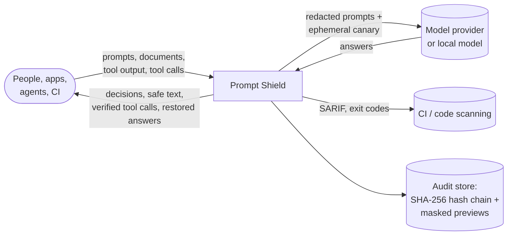
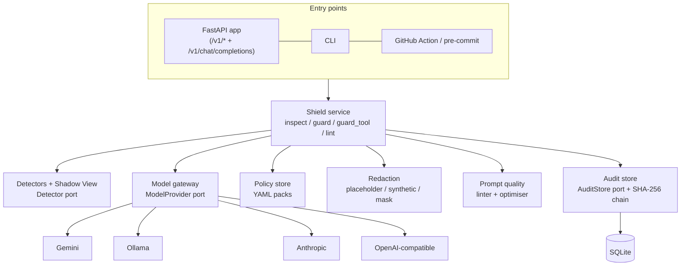
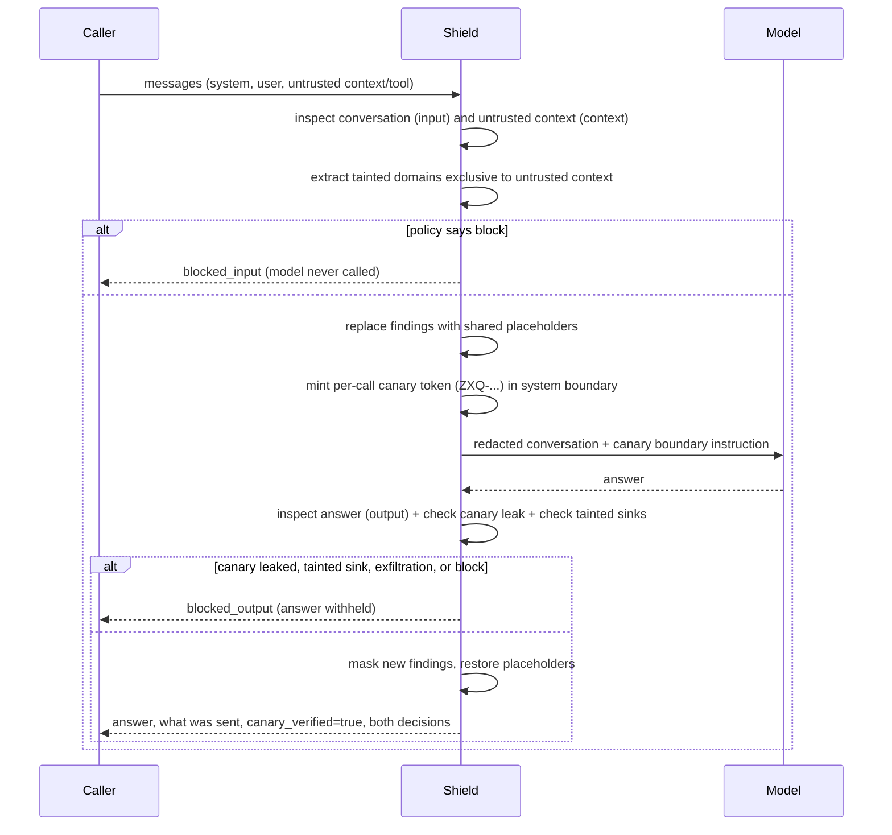

# Architecture

Zero-Trust Prompt Shield sits between people, applications and agents on one side and language models on the other.
It treats every piece of text as untrusted until inspected: the prompt a person writes, the documents and tool output
an agent pulls into context, the structured tool calls an agent proposes, and the answer a model returns. One principle
shapes every component: **the AI proposes, the engine verifies.** Rules decide what is a finding; a model may suggest
more, but nothing it says is accepted until the engine has tied it to an exact span of the text.

## 1. System context

Everything outside the box is reached through a port: model providers behind one gateway, the audit store behind a
repository interface, and policy packs loaded from files. The shield works with no model; models add reach, never
authority.

## 2. The pipeline

Every entry point (API, OpenAI proxy, CLI, GitHub Action, pre-commit hook, guard) calls the same `Shield` pipeline:

| Step | Component | Notes |
|---|---|---|
| Normalise & shadow view | `detection.base.Document` | Line index for positions; for a diff, only added lines are in scope. Builds a coordinate-preserving de-obfuscation shadow view (`doc.normalized` + `_norm_to_orig`) when non-ASCII characters are present, stripping invisible controls and folding Cyrillic/Greek/full-width homoglyphs ([ADR 0008](adr/0008-coordinate-preserving-deobfuscation-shadow-view.md)). |
| Detect | `detection/*` | Pattern rules with validators (checksums, placeholder checks), entropy, injection and obfuscation detectors, restricted terms from the policy. Injection, confidentiality and secret rules run on both `doc.text` and `doc.normalized`, mapping shadow spans back to exact original offsets. |
| Resolve | `detection.resolve_overlaps` | One finding per stretch of text: a provider-specific key beats the generic entropy rule on the same token. |
| Suppress | `audit.suppressed()` | Findings people marked "not an issue" are kept but marked suppressed, matched by fingerprint (`SHA-256` or `HMAC-SHA256`). |
| Propose | `ai.semantic.SemanticReviewer` | Optional. The model sees the text with every rule finding replaced by a placeholder, inside a randomly delimited block. |
| Verify | same | Category in the taxonomy, confidence of at least 0.55, evidence an exact (whitespace-tolerant) span of what the model saw, mapped back to the original. Quotes that run over handled values are trimmed to what the model added; injections must address an AI; personal and customer data must name someone. Rejections are kept with their reason. |
| Decide | `policy.Policy.decide` | Each finding takes the action of the first matching rule; the decision is the most restrictive, raised to block at the pack's risk threshold. Hard guard invariants (`Action.BLOCK`) are never downgraded. |
| Act | `redaction` | `mask` (one-way), `placeholder` (reversible `<<EMAIL_1>>`), or `synthetic` (reversible RFC-reserved format-preserving surrogates such as `user1@redacted.invalid`, `192.0.2.1`). |
| Record | `audit.SqliteAuditStore` | Hash, length, decision, masked findings, timings, and a tamper-evident hash chain link (`prev_hash` -> `entry_hash`). No text, no raw values. |

## 3. Directions

The same pattern means different things depending on where the text sits:

| Direction | Text | What matters most |
|---|---|---|
| `input` | A prompt someone is about to send | Leaks: credentials, personal data, internal details. Jailbreak attempts are warnings. |
| `context` | Retrieved documents, web pages, tool results | Indirect injection: instructions, hidden text, homoglyph/zero-width evasion and encoded payloads become critical. External domains are recorded as tainted sources. |
| `output` | A model's answer or tool call | Exfiltration channels (markdown image beacons, leaked canary tripwires, tainted sinks from untrusted context), SSRF/shell injection in tool arguments, or personal data the user never supplied. |

Detectors take the direction into account (`severity_by_direction`), and policy rules can match on it.

## 4. Layers and ports

- **Domain** (`domain/`) holds findings, spans, decisions and results. It has no I/O. `Finding.value` (the raw match) is
  excluded from every serialised form; the public view carries a masked preview and a fingerprint (`SHA-256` or
  `HMAC-SHA256` when `SHIELD_FINGERPRINT_KEY` is set).
- **Detection** is a set of plug-ins behind the `Detector` protocol. Most are declarative `PatternRule` lists; adding a
  credential format is a data change. `Document` provides the coordinate-preserving de-obfuscation shadow view.
- **Model gateway** (`ai/gateway.py`) is the only way to call a model. It enforces an input cap and a deadline and
  turns every failure into `ModelUnavailable`, so callers always have a rules-only path. Providers use plain HTTP.
- **Policy engine** reads YAML packs. Built-in packs ship with the package; `SHIELD_POLICY_DIR` adds your own.
- **Prompt quality** has a deterministic linter (16 checks across five dimensions) and an optimiser that only keeps a
  model rewrite when deterministic checks pass.
- **Audit store** is a small repository interface with a SQLite implementation that links every inspection into a
  tamper-evident SHA-256 hash chain (`verify_chain()`).

## 5. Guarded chat, canary tripwires & taint tracking

## 6. Agent tool-call guard (`Shield.guard_tool`)

Before an agent executes a tool proposed by a model, `POST /v1/guard/tool` inspects the structured JSON arguments:

1. Runs all output-direction detectors across the serialised arguments (secrets, PII, financial, network, injection).
2. Screens arguments for **SSRF and local resource targets** (`exfiltration.tool_ssrf`): cloud metadata services
   (`169.254.x.x`, `100.100.x.x`), loopback (`localhost`, `127.0.0.1`, `[::1]`),
   and local schemes (`file://`, `gopher://`, `dict://`).
3. Screens arguments for **shell command injection and path traversal** (`injection.tool_shell`): command chaining
   (`;`, `&&`, `||`, `|`) into shell/network binaries, subshells (`$(...)`, backticks), `/etc/passwd`, `/etc/shadow`,
   and `../../` traversal.
4. Enforces **cross-boundary taint tracking** (`exfiltration.tainted_sink`) when `untrusted_text` is supplied: blocks
   any tool call that attempts to contact a domain introduced by untrusted context.

## 7. Security of the shield itself

- Text and raw values are never logged or stored. Request logs carry method, path, status, duration and a request id.
- Every audit entry is chained via SHA-256 (`prev_hash` -> `entry_hash`) from `GENESIS`; `GET /v1/audit/verify` and
  `promptshield audit-verify` detect any modified or deleted row.
- Optional `SHIELD_FINGERPRINT_KEY` switches finding fingerprints to `HMAC-SHA256`.
- Optional API key (constant-time comparison), per-client rate limit, body size limit, strict CORS, `no-store` caching.
- The model's input is capped and delimited with a random marker; the model is told the block is data.
- Model output is parsed defensively and never executed or trusted; see [security-model.md](security-model.md).

## 8. Quality

- 94 backend tests (detectors, de-obfuscation shadow view, hostile-input timing, policies, placeholder and synthetic redaction, AI verification with a scripted provider, canary tripwires, taint tracking, tool guard, audit hash chain, prompt quality, API, CLI), ruff and mypy in strict mode, all in CI.
- A labelled corpus with hard negatives plus 90 adversarial mutation variants; the benchmark runs in CI and fails the build if recall drops.
- Credential-shaped test values are assembled at run time, so the repository holds nothing a secret scanner would flag.
