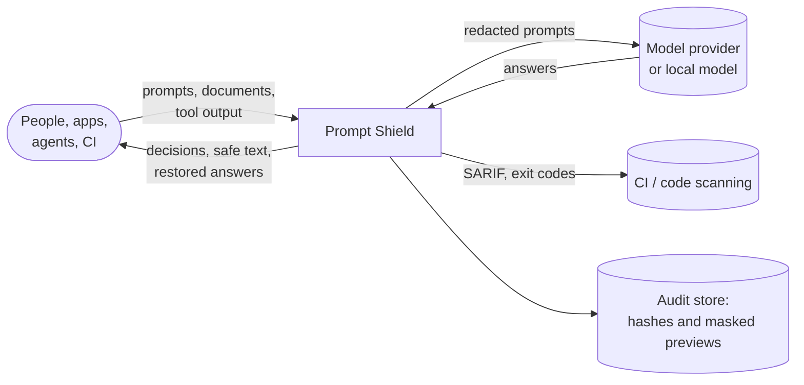
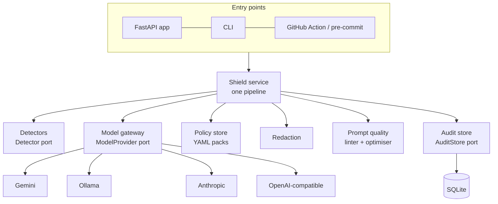
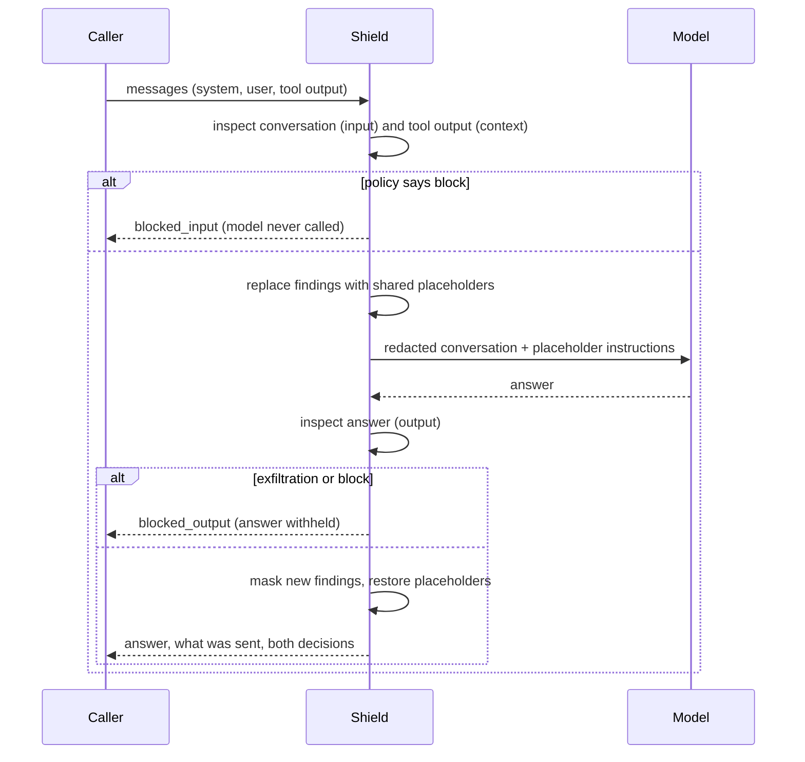

# Architecture

Zero-Trust Prompt Shield sits between people, applications and agents on one side and language models on the other.
It treats every piece of text as untrusted until inspected: the prompt a person writes, the documents and tool output
an agent pulls into context, and the answer a model returns. One principle shapes every component: **the AI proposes,
the engine verifies.** Rules decide what is a finding; a model may suggest more, but nothing it says is accepted until
the engine has tied it to an exact span of the text.

## 1. System context

Everything outside the box is reached through a port: model providers behind one gateway, the audit store behind a
repository interface, and policy packs loaded from files. The shield works with no model; models add reach, never
authority.

## 2. The pipeline

Every entry point (API, CLI, GitHub Action, pre-commit hook, guard) calls the same `Shield.inspect`:

| Step | Component | Notes |
|---|---|---|
| Normalise | `detection.base.Document` | Line index for positions; for a diff, only added lines are in scope. |
| Detect | `detection/*` | Pattern rules with validators (checksums, placeholder checks), entropy, injection and obfuscation detectors, restricted terms from the policy. |
| Resolve | `detection.resolve_overlaps` | One finding per stretch of text: a provider-specific key beats the generic entropy rule on the same token. |
| Suppress | `audit.suppressed()` | Findings people marked "not an issue" are kept but marked suppressed, matched by fingerprint. |
| Propose | `ai.semantic.SemanticReviewer` | Optional. The model sees the text with every rule finding replaced by a placeholder, inside a randomly delimited block. |
| Verify | same | Category in the taxonomy, confidence of at least 0.55, evidence an exact (whitespace-tolerant) span of what the model saw, mapped back to the original. Quotes that run over handled values are trimmed to what the model added; injections must address an AI; personal and customer data must name someone. Rejections are kept with their reason. |
| Decide | `policy.Policy.decide` | Each finding takes the action of the first matching rule; the decision is the most restrictive, raised to block at the pack's risk threshold. |
| Act | `redaction` | Mask (one-way) or placeholders (reversible, mapping returned to the caller only). |
| Record | `audit.SqliteAuditStore` | Hash, length, decision, masked findings, timings. No text, no raw values. |

## 3. Directions

The same pattern means different things depending on where the text sits:

| Direction | Text | What matters most |
|---|---|---|
| `input` | A prompt someone is about to send | Leaks: credentials, personal data, internal details. Jailbreak attempts are warnings. |
| `context` | Retrieved documents, web pages, tool results | Indirect injection: instructions, hidden text, encoded payloads become critical. |
| `output` | A model's answer | Exfiltration channels (markdown image beacons), personal data the user never supplied. |

Detectors take the direction into account (`severity_by_direction`), and policy rules can match on it.

## 4. Layers and ports

- **Domain** (`domain/`) holds findings, spans, decisions and results. It has no I/O. `Finding.value` (the raw match) is
  excluded from every serialised form; the public view carries a masked preview and a fingerprint.
- **Detection** is a set of plug-ins behind the `Detector` protocol. Most are declarative `PatternRule` lists; adding a
  credential format is a data change. Policies choose which detectors run.
- **Model gateway** (`ai/gateway.py`) is the only way to call a model. It enforces an input cap and a deadline and
  turns every failure into `ModelUnavailable`, so callers always have a rules-only path. Providers use plain HTTP.
- **Policy engine** reads YAML packs. Built-in packs ship with the package; `SHIELD_POLICY_DIR` adds your own.
- **Prompt quality** has a deterministic linter (16 checks across five dimensions) and an optimiser that only keeps a
  model rewrite when deterministic checks pass.
- **Audit store** is a small repository interface with a SQLite implementation; a shared database can implement the
  same protocol for multi-instance deployments.

## 5. Guarded chat

## 6. Security of the shield itself

- Text and raw values are never logged or stored. Request logs carry method, path, status, duration and a request id.
- Optional API key (constant-time comparison), per-client rate limit, body size limit, strict CORS, `no-store` caching.
- The model's input is capped and delimited with a random marker; the model is told the block is data.
- Model output is parsed defensively and never executed or trusted; see [security-model.md](security-model.md).

## 7. Quality

- 88 backend tests (detectors, hostile-input timing, policies, redaction, AI verification with a scripted provider, prompt quality, API, CLI),
  ruff and mypy in strict-ish mode, all in CI.
- A labelled corpus with hard negatives; the benchmark runs in CI and fails the build if recall drops.
- Credential-shaped test values are assembled at run time, so the repository holds nothing a secret scanner would flag.
